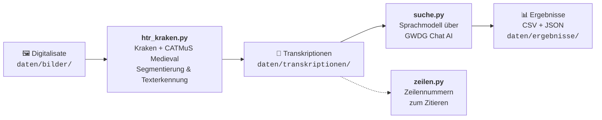

<div align="center">

# HTR Analyse Kraken

**Handschriftenerkennung und Begriffssuche für römische Notarskursive des 15. Jahrhunderts**

[](https://www.python.org/)
[](https://kraken.re/)
[](https://doi.org/10.5281/zenodo.10066219)
[](https://docs.hpc.gwdg.de/services/ai-services/chat-ai/)
[](LICENSE)

</div>

---

Dieses Repository enthält eine kleine, nachnutzbare Pipeline, mit der sich Digitalisate spätmittelalterlicher Handschriften automatisch transkribieren und anschließend nach bestimmten Begriffen durchsuchen lassen. Entstanden ist sie im Rahmen eines Praktikums in der Abteilung Digital Humanities des Deutschen Historischen Instituts in Rom, angewandt auf Bestände in römischer Notarskursive (*cursiva romana notarilis* / *scrittura curiale romana*).

Im konkreten Anwendungsfall wurde nach Erwähnungen von Jüdinnen und Juden gesucht (lateinisch *iudeus*, *iudaeus* und ihre Flexionsformen). Die Suchbegriffe lassen sich aber beliebig austauschen.

## Inhalt

- [Wie funktioniert die Pipeline?](#wie-funktioniert-die-pipeline)
- [Die Skripte im Überblick](#die-skripte-im-überblick)
- [Ordnerstruktur](#ordnerstruktur)
- [Installation](#installation)
- [Benutzung](#benutzung)
- [Ausgabeformate](#ausgabeformate)
- [Anpassen an eigene Projekte](#anpassen-an-eigene-projekte)
- [Grenzen und methodische Hinweise](#grenzen-und-methodische-hinweise)
- [Zitieren](#zitieren)
- [Lizenz und Danksagung](#lizenz-und-danksagung)

---

## Wie funktioniert die Pipeline?



1. **Texterkennung:** Jedes Seitenbild wird mit [Kraken](https://kraken.re/) in Textzeilen zerlegt (Baseline-Segmentierung) und mit dem Modell **CATMuS Medieval** transkribiert.
2. **Begriffssuche:** Jede Transkription geht an ein Sprachmodell, das nach den Suchbegriffen und ihren Wortformen sucht und Fundstellen mit Kontext zurückgibt.
3. **Ergebnis:** Eine Tabelle, die Datei, Bild, Treffer und vollständige Transkription nebeneinanderstellt, damit jeder Treffer direkt am Bild überprüft werden kann.

**Warum ein Sprachmodell statt einer einfachen Textsuche?** Automatische Transkriptionen enthalten Lesefehler, nicht aufgelöste Abkürzungen und Schreibvarianten (*u*/*v*, *i*/*j*, *e*/*ae*). Eine exakte Zeichenkettensuche würde viele echte Treffer übersehen. Das Sprachmodell erkennt auch fehlerhafte oder abgekürzte Formen.

## Die Skripte im Überblick

| Skript | Aufgabe | Eingabe | Ausgabe |
|---|---|---|---|
| [`htr_kraken.py`](htr_kraken.py) | Handschriftenerkennung mit Kraken | Bilder (`.jpg`, `.png`, `.tif`) | eine `.txt` pro Bild |
| [`suche.py`](suche.py) | Begriffssuche per Sprachmodell | `.txt`-Transkriptionen | `suchergebnisse.csv`, `suchergebnisse.json` |
| [`zeilen.py`](zeilen.py) | Zeilennummern ergänzen | eine `.txt`-Datei | `<name>_nummeriert.txt` |

## Ordnerstruktur

```
HTR-Analyse_Kraken_und_GWDG-API/
├── htr_kraken.py          # Schritt 1: Texterkennung
├── suche.py                # Schritt 2: Begriffssuche
├── zeilen.py               # Hilfsskript: Zeilennummern
├── requirements.txt        # benötigte Python-Pakete
├── .env.example            # Vorlage für den API-Schlüssel
├── modelle/                # hier das Kraken-Modell ablegen (nicht im Repository)
└── daten/
    ├── bilder/             # Eingabe: Digitalisate (nicht im Repository)
    ├── transkriptionen/    # Zwischenergebnis: Kraken-Ausgabe
    └── ergebnisse/         # Endergebnis: CSV und JSON
```

> [!NOTE]
> Bilder, Transkriptionen, Ergebnisse und das Modell werden **nicht** mit hochgeladen (siehe `.gitignore`). Die Ordner sind nur als leere Platzhalter enthalten. Für die Digitalisate gelten die Nutzungsbedingungen der jeweiligen Archive.

## Installation

### Voraussetzungen

- **Python 3.10 oder neuer**
- **Linux oder macOS.** Kraken unterstützt Windows offiziell nicht. Unter Windows funktioniert es zuverlässig im [Windows-Subsystem für Linux (WSL)](https://learn.microsoft.com/de-de/windows/wsl/install).
- Für die Suche: ein **API-Schlüssel für GWDG Chat AI** (kostenlos für Angehörige teilnehmender Einrichtungen mit Academic-Cloud-Konto)

### 1. Repository herunterladen

```bash
git clone https://github.com/NurayHaskilic/HTR-Analyse_Kraken_und_GWDG-API.git
cd HTR-Analyse_Kraken_und_GWDG-API
```

### 2. Virtuelle Umgebung anlegen und Pakete installieren

```bash
python3 -m venv .venv
source .venv/bin/activate        # unter Windows (PowerShell): .venv\Scripts\Activate.ps1
pip install -r requirements.txt
```

### 3. Modell herunterladen

Verwendet wird **CATMuS Medieval 1.6.0**, ein Kraken-Modell für mittelalterliche Handschriften in Latein, Altfranzösisch, Spanisch und Italienisch.

1. Die Modelldatei von Zenodo herunterladen: <https://doi.org/10.5281/zenodo.10066219> (der Link führt zur aktuellen Version, ältere Versionen sind dort unter *Versions* aufgelistet).
2. Die Datei als `catmus-medieval-1.6.0.mlmodel` in den Ordner `modelle/` legen.

Wer ein anderes Modell verwenden möchte, passt in `htr_kraken.py` die Variable `MODELL` an. Eine Liste verfügbarer Modelle zeigt `kraken list`.

### 4. API-Schlüssel hinterlegen

Den Schlüssel bekommt man über das Buchungsformular der GWDG bzw. von KISSKI (siehe [Dokumentation von Chat AI](https://docs.hpc.gwdg.de/services/ai-services/chat-ai/)). Dann:

```bash
cp .env.example .env
```

und in der neuen Datei `.env` den eigenen Schlüssel eintragen:

```
GWDG_API_KEY=dein_schluessel
```

> [!WARNING]
> Die Datei `.env` enthält ein persönliches Zugangsdatum und darf **nie** hochgeladen werden. Sie steht deshalb in der `.gitignore`.

## Benutzung

### Schritt 1: Bilder transkribieren

Digitalisate in `daten/bilder/` legen und starten:

```bash
python htr_kraken.py
```

Für jedes Bild entsteht in `daten/transkriptionen/` eine Datei, z. B. `beispiel.jpg` → `beispiel_transkription.txt`.

Um nur **ein einzelnes Bild** zu verarbeiten, im Skript oben einstellen:

```python
MODUS = "einzeln"
EINZELBILD = "beispiel.jpg"
```

### Schritt 2: Nach Begriffen suchen

```bash
python suche.py
```

Das Skript zeigt den Fortschritt pro Datei an und schreibt am Ende die Ergebnisse nach `daten/ergebnisse/`.

### Hilfsskript: Zeilennummern

Um Fundstellen eindeutig zitieren zu können:

```bash
python zeilen.py daten/transkriptionen/beispiel_transkription.txt
```

Ergebnis ist `beispiel_transkription_nummeriert.txt`:

```
 1: ...
 2: ...
12: ...
```

Optional kann als zweites Argument ein eigener Ausgabepfad angegeben werden.

## Ausgabeformate

### `suchergebnisse.csv`

Für Excel vorbereitet: **Semikolon** als Trennzeichen, **UTF-8 mit BOM**, damit Sonderzeichen korrekt angezeigt werden. Doppelklick genügt.

| Spalte | Inhalt |
|---|---|
| `Dateiname` | Name der Transkriptionsdatei |
| `Bildpfad` | Pfad zum zugehörigen Digitalisat (leer, wenn keins gefunden wurde) |
| `Treffer` | Antwort des Sprachmodells: gefundene Begriffe mit Kontext, `kein Treffer` oder `FEHLER (…)` |
| `Transkription` | vollständiger erkannter Text der Seite |

### `suchergebnisse.json`

Dieselben Daten maschinenlesbar, z. B. zur Weiterverarbeitung in Python:

```json
[
  {
    "Dateiname": "beispiel_transkription.txt",
    "Bildpfad": "daten/bilder/beispiel.jpg",
    "Treffer": "kein Treffer",
    "Transkription": "..."
  }
]
```

## Anpassen an eigene Projekte

Alle Einstellungen stehen jeweils oben im Skript.

| Was? | Wo? | Variable |
|---|---|---|
| Suchbegriffe | `suche.py` | `SUCHBEGRIFFE` |
| Sprachmodell für die Suche | `suche.py` | `MODELL` (verfügbare Modelle: siehe Chat-AI-Dokumentation) |
| Zusätzliche Anweisungen an das Sprachmodell | `suche.py` | `system_prompt` |
| HTR-Modell | `htr_kraken.py` | `MODELL` |
| Ordner | beide Skripte | `BILDORDNER`, `ERGEBNISORDNER`, `ORDNER` … |

Da Chat AI eine OpenAI-kompatible Schnittstelle anbietet, lässt sich `suche.py` mit geänderter `url` auch mit anderen kompatiblen Anbietern nutzen.

## Grenzen und methodische Hinweise

- **Erkennungsqualität:** CATMuS Medieval ist ein allgemeines Modell und nicht speziell auf römische Notarskursive trainiert. Bei stark kursiven Händen ist mit spürbaren Fehlerraten zu rechnen. Ein auf eigenem Material nachtrainiertes Modell (Fine-Tuning mit `ketos`) würde die Ergebnisse verbessern.
- **Graphematische Transkription:** Das Modell löst **keine Abkürzungen auf** und gibt Diakritika und hochgestellte Zeichen als eigene Unicode-Zeichen aus (NFD-Normalisierung). Abgekürzte Formen wie *iud(e)or(um)* tauchen deshalb oft nicht in Volltextform auf.
- **Sprachmodelle können sich irren:** Das Modell kann Treffer übersehen oder Fundstellen falsch wiedergeben. Die Ergebnistabelle ist ein **Findmittel**, kein Befund. Jeder Treffer muss am Digitalisat überprüft werden; deshalb steht der Bildpfad mit in der Tabelle.
- **Kein Treffer heißt nicht: kommt nicht vor.** Stichproben der Seiten ohne Treffer helfen, die Zuverlässigkeit einzuschätzen.
- **Datenschutz:** GWDG Chat AI speichert laut Anbieter keine Eingaben. Bei anderen Anbietern sollte man vorher prüfen, was mit den Daten geschieht.

## Zitieren

Wer die Skripte in der eigenen Arbeit nutzt, kann das Repository über die Schaltfläche **„Cite this repository"** auf GitHub zitieren (die Angaben stehen in [`CITATION.cff`](CITATION.cff)).

Bitte auch die verwendeten Werkzeuge zitieren:

- **Kraken:** Kiessling, Benjamin: *Kraken – an Universal Text Recognizer for the Humanities.* <https://kraken.re/>
- **CATMuS Medieval:** Pinche, Ariane; Clérice, Thibault; Chagué, Alix u. a.: *CATMuS Medieval.* Zenodo. <https://doi.org/10.5281/zenodo.10066219>
- **GWDG Chat AI:** siehe Zitationshinweis in der [Dokumentation](https://docs.hpc.gwdg.de/services/ai-services/chat-ai/)

## Lizenz und Danksagung

Der Code steht unter der [MIT-Lizenz](LICENSE) und darf frei genutzt, verändert und weitergegeben werden.

Entstanden während eines Praktikums in der Abteilung Digital Humanities am Deutschen Historischen Institut in Rom. Die Rechte an den Digitalisaten liegen bei den besitzenden Einrichtungen; sie sind nicht Teil dieses Repositorys.
