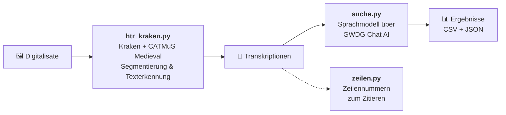

<div align="center">


**Handschriftenerkennung und Begriffssuche für römische Notarskursive**

[](https://www.python.org/)
[](https://kraken.re/)
[](https://doi.org/10.5281/zenodo.10066219)
[](https://docs.hpc.gwdg.de/services/ai-services/chat-ai/)
[](LICENSE)

</div>

---

Dieses Repository enthält eine Pipeline in Entwicklung (Stand Oktober 2026), mit der sich Digitalisate mittelalterlicher Handschriften automatisch transkribieren und anschließend nach bestimmten Begriffen durchsuchen lassen. Entstanden ist sie im Rahmen eines Praktikums in der Abteilung Digital Humanities des Deutschen Historischen Instituts in Rom, angewandt auf Bestände in römischer Notarskursive.

Die genutzten Digitalisate und Suchbegriffe werden hier nicht geteilt.




1. **Texterkennung:** Das Digitalisat wird mit [Kraken](https://kraken.re/) in Textzeilen zerlegt (Baseline-Segmentierung) und mit dem Modell **CATMuS Medieval** (https://zenodo.org/records/10066219) transkribiert.
2. **Begriffssuche:** Die Transkription wird mit einem Sprachmodell verarbeitet und auf die gewünschten Suchbegriffe/Anfrage durchsucht.

| Skript | Aufgabe | Eingabe | Ausgabe |
|---|---|---|---|
| [`htr_kraken.py`](htr_kraken.py) | Handschriftenerkennung mit Kraken | Bilder (`.jpg`, `.png`, `.tif`) | eine `.txt` pro Bild |
| [`suche.py`](suche.py) | Begriffssuche per Sprachmodell | `.txt`-Transkriptionen | `suchergebnisse.csv`, `suchergebnisse.json` |
| [`zeilen.py`](zeilen.py) | Zeilennummern ergänzen | eine `.txt`-Datei | `<name>_nummeriert.txt` |


## Installation

### Voraussetzungen

- Windows mit [Python 3.10 oder neuer](https://www.python.org/downloads/)
- Repository
- für die Begriffssuche ein API-Schlüssel für GWDG Chat AI (kostenlos für Angehörige teilnehmender Einrichtungen mit Academic-Cloud-Konto)


#### Virtuelle Umgebung

Kraken und die übrigen Pakete werden in einer virtuellen Umgebung installiert. Das ist ein eigener Ordner (`venv`), in dem nur die Pakete für dieses Projekt liegen. Die Umgebung ist in Python bereits enthalten und muss nicht extra installiert werden.

Umgebung anlegen, aktivieren und Pakete installieren:

```powershell
py -m venv venv
.\venv\Scripts\activate
pip install -r requirements.txt
```

Ist die Umgebung aktiv, steht `(venv)` am Anfang der Zeile im Terminal. Bei jeder weiteren Nutzung muss sie zuerst wieder aktiviert werden:

```powershell
.\venv\Scripts\activate
```

#### Modell

Verwendet wird **CATMuS Medieval 1.6.0**, ein Kraken-Modell für mittelalterliche Handschriften in Latein, Altfranzösisch, Spanisch und Italienisch.

1. Die Modelldatei von Zenodo herunterladen: <https://doi.org/10.5281/zenodo.10066219> 
2. Die Datei als `catmus-medieval-1.6.0.mlmodel` in den Ordner `modelle/` legen.


### API-Schlüssel hinterlegen

Den Schlüssel bekommt man über das Buchungsformular der GWDG bzw. von KISSKI (siehe [Dokumentation von Chat AI](https://docs.hpc.gwdg.de/services/ai-services/chat-ai/)). Dann:

```bash
cp .env.example .env
```

und in der neuen Datei `.env` den eigenen Schlüssel eintragen:

```
GWDG_API_KEY=dein_schluessel
```

> [!WARNING]
> Die Datei `.env` enthält ein persönliches Zugangsdatum und darf **nie** hochgeladen werden. Sie steht deshalb in der `.gitignore`.

## Benutzung

### Schritt 1: Bilder transkribieren

Digitalisate in `daten/bilder/` legen und starten:

```bash
python htr_kraken.py
```

Für jedes Bild entsteht in `daten/transkriptionen/` eine Datei, z. B. `beispiel.jpg` → `beispiel_transkription.txt`.

Um nur **ein einzelnes Bild** zu verarbeiten, im Skript oben einstellen:

```python
MODUS = "einzeln"
EINZELBILD = "beispiel.jpg"
```

### Schritt 2: Nach Begriffen suchen

```bash
python suche.py
```

Das Skript schreibt am Ende die Ergebnisse nach `daten/ergebnisse/`.

### Hilfsskript: Zeilennummern

Um Fundstellen eindeutig zitieren zu können:

```bash
python zeilen.py daten/transkriptionen/beispiel_transkription.txt
```

Ergebnis ist `beispiel_transkription_nummeriert.txt`:

```
 1: ...
 2: ...
12: ...
```

Optional kann als zweites Argument ein eigener Ausgabepfad angegeben werden.

## Ausgabeformate

### `suchergebnisse.csv`


| Spalte | Inhalt |
|---|---|
| `Dateiname` | Name der Transkriptionsdatei |
| `Bildpfad` | Pfad zum zugehörigen Digitalisat (leer, wenn keins gefunden wurde) |
| `Treffer` | Antwort des Sprachmodells: gefundene Begriffe mit Kontext, `kein Treffer` oder `FEHLER (…)` |
| `Transkription` | vollständiger erkannter Text der Seite |

### `suchergebnisse.json`

```json
[
  {
    "Dateiname": "beispiel_transkription.txt",
    "Bildpfad": "daten/bilder/beispiel.jpg",
    "Treffer": "kein Treffer",
    "Transkription": "..."
  }
]
```

## Anpassen an eigene Projekte

Alle Einstellungen stehen jeweils oben im Skript.

| Was? | Wo? | Variable |
|---|---|---|
| Suchbegriffe | `suche.py` | `SUCHBEGRIFFE` |
| Sprachmodell für die Suche | `suche.py` | `MODELL` (verfügbare Modelle: siehe Chat-AI-Dokumentation) |
| Zusätzliche Anweisungen an das Sprachmodell | `suche.py` | `system_prompt` |
| HTR-Modell | `htr_kraken.py` | `MODELL` |
| Ordner | beide Skripte | `BILDORDNER`, `ERGEBNISORDNER`, `ORDNER` … |

Da Chat AI eine OpenAI-kompatible Schnittstelle anbietet, lässt sich `suche.py` mit geänderter `url` auch mit anderen kompatiblen Anbietern nutzen.


## Zitieren

Wer die Skripte in der eigenen Arbeit nutzt, kann das Repository über die Schaltfläche **„Cite this repository"** auf GitHub zitieren (die Angaben stehen in [`CITATION.cff`](CITATION.cff)).

Bitte auch die verwendeten Werkzeuge zitieren:

- **Kraken:** Kiessling, Benjamin: *Kraken – an Universal Text Recognizer for the Humanities.* <https://kraken.re/>
- **CATMuS Medieval:** Pinche, Ariane; Clérice, Thibault; Chagué, Alix u. a.: *CATMuS Medieval.* Zenodo. <https://doi.org/10.5281/zenodo.10066219>
- **GWDG Chat AI:** siehe Zitationshinweis in der [Dokumentation](https://docs.hpc.gwdg.de/services/ai-services/chat-ai/)

## Lizenz und Danksagung

Der Code steht unter der [MIT-Lizenz](LICENSE) und darf frei genutzt, verändert und weitergegeben werden.

Entstanden während eines Praktikums in der Abteilung Digital Humanities am Deutschen Historischen Institut in Rom. Die Rechte an den Digitalisaten liegen bei den besitzenden Einrichtungen und sind nicht Teil dieses Repositorys.
